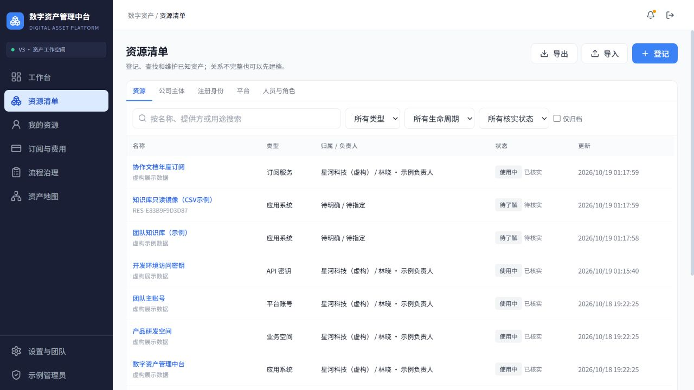
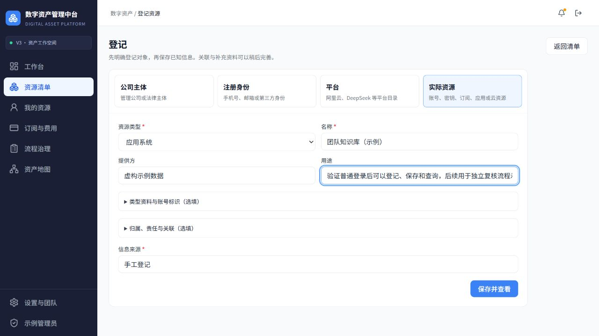

# 数字资产管理中台 · Digital Asset Platform

**为团队统一管理平台账号、访问凭据、云资源与订阅费用的 Web 应用。**

把“资源在哪里、属于谁、谁在使用、何时续费、如何交接”放到同一条业务链路中。支持真实登记和查询、归属与授权、加密凭据、订阅台账、平台余额同步及可追溯的交接流程。

A deployable web application for team accounts, credentials, subscriptions, and resource governance.

[](https://github.com/coldwind-fss/digital-asset-platform/actions/workflows/digital-asset-platform-contract.yml)

**[在线体验](https://114.55.146.5:8093/) · [产品与业务流程](docs/public/PRODUCT.md) · [技术架构](docs/public/ARCHITECTURE.md) · [本地运行](docs/public/QUICKSTART.md) · [验证与交付](docs/public/VERIFICATION.md)**



## 在线体验

打开 **[完整应用](https://114.55.146.5:8093/)**，登录页已填好公开示例账号，点击登录即可操作。

| 账号 | 密码 | 用途 |
| --- | --- | --- |
| `demo` | `Demo-Product-2026!` | 登记、编辑、查询与业务操作 |
| `reviewer` | `Review-Product-2026!` | 用另一身份完成独立复核 |

这是同一个完整产品，示例账号使用正常登录和权限规则。演示数据为虚构；登记、编辑和流程操作会真实保存。所有访问者共享这份数据，请使用虚构内容，不要录入个人密码或真实 API Key。在线数据可能随体验操作变化，截图为交付检查点。

**建议体验路径（约 5 分钟）：**

1. 在“资源清单”右上角点击“登记”，选择类型，填写基本信息后保存；上下游关系可以稍后补充。
2. 打开资源详情，查看归属、责任人、关联资源、资料和变更记录。
3. 在“订阅与费用”查看周期、到期提醒、人工费用与余额快照。
4. 在“流程治理”查看交接和授权变更；执行人与独立确认人分别操作。
5. 在“资产地图”探索同一批资源的关系。

## 系统解决什么问题

例如，团队在某平台购买了 API 服务：登记平台账号和服务，标明公司归属与负责人，将凭据加密保存并明确授权，再维护订阅和费用。负责人变更时，通过交接流程记录执行证据，由另一人确认后更新事实；其他页面立即读取同一份数据。

| 页面 | 主要工作 |
| --- | --- |
| 工作台 | 从当前资源、待处理流程和到期事项开始 |
| 资源清单 | 分类查询、分型登记、关系维护、导入导出和资源详情 |
| 我的资源 | 从个人责任和使用关系查看同一批资源 |
| 订阅与费用 | 周期、续费、到期提醒、人工费用及平台余额快照 |
| 流程治理 | 交接、授权调整、停用及执行与独立确认 |
| 资产地图 | 探索已有关系的辅助视图 |

“设置与团队”维护人员、角色及个人通知偏好。登记入口集中在资源清单；不同视图共用档案，不重复建账。

## 产品设计

- **保留业务结构，允许逐步补齐。** 公司、注册身份、平台、实际账号、人员使用关系、服务与资源构成分类模型；登记时直接选择对象，不必先补齐一整条层级链。
- **信息围绕当前任务展示。** 紧凑列表、分型表单、按需展开资料，减少重复入口和大面积空白。
- **治理影响真实事实。** 流程有状态、版本和证据；执行与独立确认分离，确认后更新档案并保留历史。
- **凭据与普通档案分开。** 加密存储、明确授权、近期认证和审计；普通列表及导出不携带秘密明文。



## 技术实现

| 层次 | 实现 |
| --- | --- |
| 前端 | Vue 3、TypeScript、Vite、Vue Router、Tailwind CSS；统一管理系统视觉 |
| 后端 | FastAPI、SQLAlchemy 2、Pydantic；模块化单体与独立任务 worker |
| 数据 | PostgreSQL、Alembic；17 次显式迁移，运行与迁移角色分离 |
| 契约 | OpenAPI 3.1、生成 TypeScript DTO、契约与模块依赖检查 |
| 权限与凭据 | 服务端会话、角色/对象范围、CSRF、AES-256-GCM、受控查看与审计 |
| 部署 | Nginx、HTTPS、systemd、锁文件构建、版本清单、数据库及附件备份恢复 |

后端按资源、目录、人员与身份、使用关系、凭据、订阅、集成、治理、资料、来源追踪划分模块。首批外部集成实现 DeepSeek 账户余额读取；人工费用与外部余额分别记录。[查看架构及源码阅读入口 →](docs/public/ARCHITECTURE.md)

## 项目结构

```text
backend/
  app/modules/      # 业务模块
  app/platform/     # 配置、数据库及基础能力
  alembic/          # 数据库迁移
  openapi/          # API 契约
  tests/            # 单元与真实 PostgreSQL 集成测试
frontend/
  src/features/v3/  # 当前产品页面
  src/shared/       # 公共组件与 API DTO
deploy/             # 服务器配置、初始化、备份恢复及运行手册
scripts/            # 本地启停与发布包构建
docs/public/        # 产品、架构、运行、验证与评审文档
.github/workflows/  # 持续集成
```

## 本地运行与评审

环境：Python 3.12、uv、Node.js 24、PostgreSQL 16+。锁文件已提交；本地开发、测试与恢复使用独立数据库。按 **[本地运行指南](docs/public/QUICKSTART.md)** 完成数据库准备、迁移、API、worker 和前端启动。新安装从空库初始化自己的账号，公开在线示例账号不会自动写入本地数据库。

**2026-10-19 验证：103 项后端测试通过**，覆盖真实 PostgreSQL；契约、DTO、模块边界及前端构建通过。服务器完成 HTTPS 访问、真实写入、治理、附件、导入和恢复验证。当前交付基于 `dap-v3-20261019-rc7`；最新远端检查以页面上方 CI 为准。[验证范围与限制 →](docs/public/VERIFICATION.md)

同行可以从 **[评审指南与实施追踪](docs/public/REVIEW.md)** 开始，按“产品决策 → 模块/API → 测试与发布”查看证据。本仓库保留当前应用所需源码、锁文件、迁移和部署工具；早期旧版工程、原始业务材料、私有运行配置及密钥未纳入公开发布。
