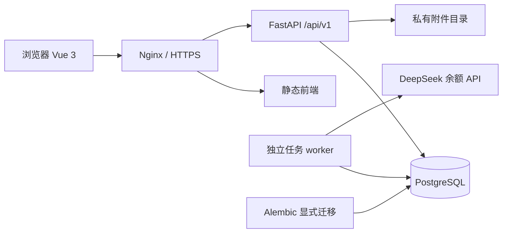

# 技术架构与源码入口

[返回首页](../../README.md) · [本地运行](QUICKSTART.md)

## 总体结构

模块化单体便于在单台服务器部署和理解事务。API 与 worker 分别运行，复用业务代码和数据库；任务不依赖 Web 进程里的定时器。当前物理表仍在共享的模型注册文件中统一定义，模块依赖检查约束业务依赖方向。

## 模块职责

源码位于 [backend/app/modules](../../backend/app/modules)。

| 模块 | 职责 |
| --- | --- |
| resources | 类型、档案、版本与生命周期 |
| directory | 公司、注册身份、平台及目录关系 |
| identity_access | 本地身份、会话、团队与权限 |
| bindings | 人员责任及使用关系 |
| credentials | 加密凭据、显式授权、近期认证与审计 |
| subscriptions | 订阅、费用、续费、到期和通知偏好 |
| integrations | 平台连接、指标快照与后台任务 |
| governance | 交接、授权调整、停用及独立确认 |
| materials | 私有附件、导入与导出 |
| provenance | 来源、追踪与历史 |

## 重要实现选择

### 同一事实，多种视图

前端资源清单、我的资源、详情和地图读取同一资源 ID。人员关系、目录、订阅和流程分别持有业务事实，页面通过已定义 API 组合展示。详情不另存一份用于展示的影子档案。

前端入口：[路由](../../frontend/src/router/index.ts)、[业务页面](../../frontend/src/features/v3)、[共享 API](../../frontend/src/shared/api)。

### 契约与模块边界

契约：[OpenAPI 3.1](../../backend/openapi/v1.openapi.json)。API 主版本是 `/api/v1`，独立于产品 V3 的产品迭代名称。

前端 DTO 从契约生成，CI 检查契约语义及生成漂移。当前契约声明 127 个操作，运行时注册 119 个，另 8 个为历史规划项；不能把声明数当成已实现接口数。运行时无契约外业务操作，相关差异由测试检查。

入口：[app/main.py](../../backend/app/main.py)、[边界检查](../../backend/scripts/check_import_boundaries.py)、[契约测试](../../backend/tests/test_openapi_contract.py)。

[逐项 API 实施清单](API_INVENTORY.md) 来自实际注册检查；在 backend 运行 `uv run python scripts/inventory_api.py` 可重新生成 `.local/workspace/api-inventory.json` 和同名 Markdown 报告。

### 数据库和事务

SQLAlchemy 2 + PostgreSQL + psycopg。Alembic 显式升级，应用启动不执行 DDL。运行角色与迁移角色分离，迁移前核对数据库名和实例；本地 dev/test/restore 也分离。当前迁移头为 `0017_notification_preferences`。

对并发敏感的变更检查版本；治理确认将流程状态和事实更新纳入事务，重复请求及并发行为由集成测试验证。源码：[模型](../../backend/app/platform/db/models.py)、[迁移](../../backend/alembic/versions)。

### 会话与秘密

本地账号使用服务端会话、密码哈希、Cookie 和 CSRF/Origin 校验，生产 Cookie 使用 Secure。服务端执行角色、范围和动作检查。

秘密使用 AES-256-GCM 加密。主密钥来自私有配置，支持读旧钥/写新钥与轮换验证。查看需要明确授权和近期认证；普通 DTO、CSV 与日志不得携带明文。公开示例账号密码属于有意公开的数据，真实凭据及主密钥不进入前端 VITE 配置。

### 任务、附件与恢复

worker 读取 PostgreSQL 任务记录，处理租约、重试和心跳。首批 DeepSeek 适配器只读余额，调用失败时保留既有快照并呈现错误。API 的 ready 健康检查通过不等于 worker 或供应商成功。

入口：[worker](../../backend/app/worker.py)、[integrations](../../backend/app/modules/integrations)。

附件位于私有目录，经鉴权下载；限制格式、文件签名和 10 MiB 大小。数据库、附件、对应密钥与配置共同构成恢复所需状态。发布包逐文件 SHA256，数据库恢复在独立目标验证，不能将源码回退视为数据回退。

部署与故障处理见 [运行手册](../../deploy/RUNBOOK.md)。本机每日备份已配置；异机备份目标仍未指定，当前不具备整机损失后的异地恢复保证。
